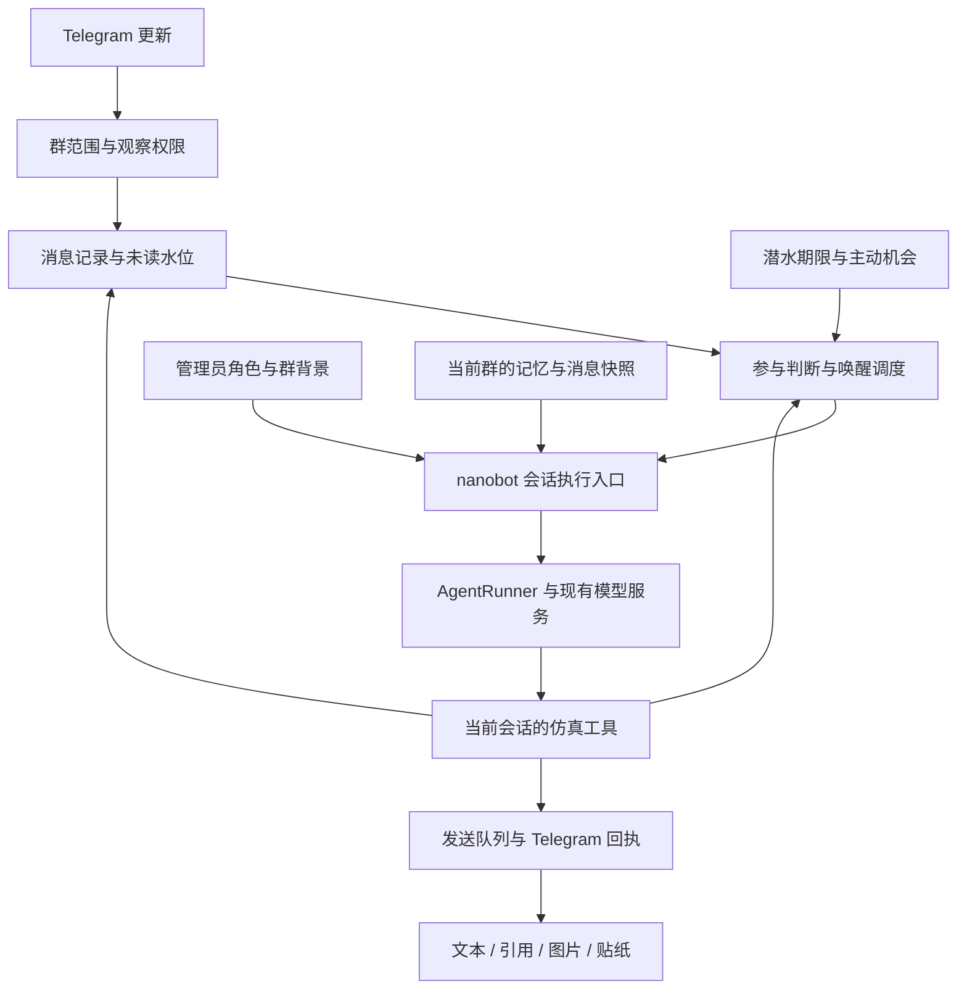

# Telegram 仿真 AI 群友迁移计划

> 状态：M0、M1、M2 和 M3 首批（图片、引用与静态贴纸）已完成实现、离线验收及本机发布；M4、M5 尚未开始。仿真在当前实际实例已按本人配置启用。GIF/WebM/TGS 本批提供缩略图或元信息降级，逐帧理解和动画发送按需后续扩展。当前部署以 [本机管线说明](docs/LOCAL_PIPELINE.md) 及实例 state.json 为准。
> 目标：把 qq-bridge 的群友仿真、人格、多媒体及群内记忆能力移植到 nanobot，使用 Telegram 收发消息，保持 nanobot 的轻量与可扩展性。
> 最近核对：2026-10-28，已按上游冗余文件清理后的目录与当前生产部署方式复核。日常发布操作以 [本机管线说明](docs/LOCAL_PIPELINE.md) 为准。
> 本机部署记录：M0–M2 已提交为 `798d172d` 并部署到独立验证实例（8766 / 18791），健康检查与安装包离线验证通过；该次部署未切换实际使用实例，详见 [部署记录](docs/M2_DEPLOYMENT.md)。用户后续明确：个人本机使用，无测试群前置要求，后续功能批次默认及时部署到实际使用实例（8765 / 18790），以 [本机迭代约定](docs/LOCAL_PIPELINE.md) 为准。
> 当前实际实例：已部署 `e3505c3b`，包含 M0–M3 首批、群流式延迟修复及角色来源查询修复，健康检查通过、Telegram 已连接；social 已启用，既有群/话题授权及角色与发布前备份一致。媒体库 schema 2→3 升级、完整性和水位保留检查通过。详见 [M3 说明](docs/M3_IMPLEMENTATION.md)。

## 1. 源码基线与范围

| 项目 | 本地位置 | 分析基线 | 用途 |
| --- | --- | --- | --- |
| nanobot | `/home/ubuntu/nanobot-bridge-tg` | 上游功能分析基线为 `v0.3.5`、提交 `1bb712d3`；本地开发分支为 `main` | 实现目标；`origin` 为 `FayeValentina/nanobot-bridge-tg`；在此基础上已加入本机发布管线并清理上游冗余资料 |
| qq-bridge | `/home/ubuntu/qq-bridge` | `0.2.1-r1`，提交 `a49877f` | 行为、提示词、数据结构与测试案例的参考 |

当前生产运行本地源码构建的 Docker 镜像，原 uv 发布包与旧 systemd 服务单元已移除。源码修改提交后，通过 `./scripts/pipeline.sh release` 完成测试、构建、备份、部署与健康检查；保存源码不会自动热更新。GitHub 仅用于代码版本管理。

本次复核时，工作分支已完成清理至 `efad953e`；生产镜像仍对应已验证的提交 `fbfe7a3c`，后续提交仅涉及清理与文档。该记录用于区分源码分析、工作分支和运行产物，不作为后续发布的固定版本要求。功能开发从当前 `main` 开始。

项目保留的构建部署入口为 `scripts/` 和 `deploy/`。上游 GitHub Actions、Render、根目录旧 Docker 方案及公开发布文档已移除，后续开发复用现有本机管线。

本计划包含以下八项能力：

| 功能 | 实现方向 | 源码分析后的工作量判断 |
| --- | --- | --- |
| 人格与角色 | 角色文件、群背景、每回合注入、管理员切换 | 角色文件较低；实现按群隔离后为中等 |
| 群聊上下文 | 按群与话题记录消息、身份、时间、引用及未读水位 | 中等，后续功能的基础 |
| 群友仿真 | 旁观、参与、等待、潜水、唤醒及自主工具调用 | 核心工作 |
| 主动发言 | 事件与定时唤醒、冷却、安静时段和预算 | 中等，依赖仿真调度 |
| 图片与引用 | 复用下载与引用处理，补齐按需理解和发送确认 | 已有基础，仍需适配 |
| 贴纸与动图 | Telegram 贴纸收发、本地收藏、标签、抽帧和转换 | 中等，部分格式应分阶段支持 |
| 群内记忆 | 群背景、成员偏好、共同经历、话题与黑话 | 中等偏高，隔离是前置条件 |
| 管理界面 | 在现有 WebUI 中配置角色、活跃度、权限与行为记录 | 后续补充，后端契约先完成 |

不移植 DSH 的 Cookie 鉴权、RPC、preset 安装器、OneBot/SnowLuma 连接及 QQ 专有动作。第一轮不引入额外常驻 Node 服务、独立前端或外部数据库。

## 2. 已确认的源码事实

### 2.1 nanobot 可复用的能力

| 源码 | 已有能力 | 对本项目的意义 |
| --- | --- | --- |
| `nanobot/channels/telegram/runtime.py`：`TelegramChannel` | Telegram 收发、群消息判断、引用上下文、媒体下载、相册合并 | 扩展现有通道，保留已验证的连接链路 |
| 同文件：`_derive_topic_session_key()` | `telegram:<chat_id>:topic:<thread_id>` 话题会话 | 延续该路由方式，避免另起不兼容的会话键 |
| 同文件：`_process_message_update()` | 先校验发言者，再过滤群消息，之后下载媒体并发布入站消息 | 必须增加观察路径，普通群消息目前可能提前被丢弃 |
| `nanobot/agent/tools/context.py`：`RequestContext` | 请求级通道、群、会话、发言者信息，使用 ContextVar 绑定 | 仿真工具应从这里取得真实作用域 |
| `nanobot/agent/tools/registry.py`、`loader.py` | 工具注册、加载、参数校验、工具提供的运行时上下文 | 可以接入 Python 仿真工具，不要求保留原 MCP 进程 |
| `nanobot/agent/hook.py`、`turn_hooks.py` | 每回合 hook factory、运行前后及工具前后的钩子 | 可用于角色装配、行为记录和回合收尾；需验证上下文重建兼容性 |
| `nanobot/runtime_context.py` | 运行时上下文附加、持久化标记与展示时剥离 | 适合承载群消息快照、唤醒原因等数据 |
| `nanobot/agent/loop.py` | 会话锁、待处理消息、回合生命周期 | 群仿真复用现有执行入口，避免并发操作同一 Agent 会话 |
| `nanobot/triggers/local_store.py`、`local_runner.py` | 持久化的会话触发投递、认领、恢复、重试和运行记录 | 可评估用作唤醒投递通道；它本身不是完整的仿真定时调度器 |
| `nanobot/channels/telegram/manifest.py`、`nanobot/channels/telegram/webui/index.ts` | 通道配置契约与现有设置页扩展入口 | 后续管理能力接入现有 WebUI |

### 2.2 必须补齐的能力和限制

1. **群消息观察**：目前发言者检查和 `groupPolicy` 判断发生在消息建模之前。不能仅将 `groupPolicy` 改成 `open`，否则普通消息会直接触发 Agent，无法实现低成本旁观。
2. **贴纸入口**：当前消息过滤器包含照片、视频、动画、语音等，但未包含独立的 Sticker 过滤项；不能把现有动画处理视为完整贴纸支持。
3. **人格与记忆隔离**：`ContextBuilder` 从 Agent 工作区加载 `SOUL.md`、`USER.md` 和 `MemoryStore`。选择不同项目目录并不会自动切换这些全局文件。
4. **记忆策略粒度不足**：`SessionPolicy` 当前有 `persist`、`log_content`、`disabled_tools`，没有独立的“允许读取全局人格/记忆”和“允许进入全局记忆归档”策略。不能用关闭会话持久化来代替隔离。
5. **静默回合**：`AgentLoop._persist_turn()` 会为部分空最终回复生成兜底内容。只把 hook 的最终文本设为空，并不保证群内完全静默。
6. **工具发言去重**：现有 `message` 工具有发送目标记录和部分最终回复抑制机制。新增仿真工具、定时触发和跨话题路由必须验证能否接入同一语义。
7. **实际发送回执**：`MessageTool` 的发送回调通常是 `bus.publish_outbound`；入队成功不等于 Telegram API 已确认发送。仿真发送记录不能在入队时直接标为已送达。
8. **配置枚举缺陷（M0 已修复）**：原 Telegram manifest 引用的 `GROUP_POLICIES` 含 `allowlist`，而 `TelegramConfig.group_policy` 只接受 `open`/`mention`。现已改为 `DIRECT_GROUP_POLICIES`，并补齐公开 choices、运行时类型、默认值和配置往返的一致性回归。
9. **版本差异**：本基线 `SessionManager` 使用 JSONL 会话文件；不要把上游后续版本的会话存储设计直接套到当前分支。

### 2.3 qq-bridge 中需要保留的行为

| 参考源码/符号 | 迁移时保留的契约 |
| --- | --- |
| `src/bridge.js`：`getSocialV2State()` | 每会话独立的未读、近期消息、唤醒配置、发送预算和待说内容 |
| `appendSocialV2Message()`、`buildWakeSnapshotV2()` | 连续序号、有界快照、明确的发言者与媒体信息、消息新旧程度 |
| `noteModelMessagesV2()`、`requestedReadThroughSeqV2()`、`acknowledgeMessagesV2()` | 只允许确认实际展示给模型的连续消息水位；新到消息不能被误清空 |
| `evaluateWakeTriggerV2()`、`scheduleWakeV2()`、`sendWakePromptV2()` | 触发优先级、短窗口合并、繁忙时暂存、限频后延迟重试 |
| `setupSleepTimerV2()`、`scheduleProactiveCheckV2()` | 有限潜水、事件唤醒、主动机会、暂停后取消定时器 |
| `appendMemoryV2()` | 活跃话题、待说想法、成员印象的数量限制和过期处理 |
| `src/mcp-snowluma-safe.js` | 查看未读/近期消息、自主发言、等待、设置唤醒、记忆和贴纸工具的职责划分 |
| `dsh/agent-presets/qq-chat-v2/agent.cordis.yml` | 选择性参与、识别引用对象、消息时效、简短表达、避免重复汇报等行为要求 |
| `src/role-card.js`、`roles/` | 人格内容与行为协议分离；角色由操作者管理 |
| `src/sticker-lib.js`、`src/media-normalize.js` | 贴纸语义知识库、损坏时避免覆盖、原始媒体与模型用副本分离 |
| `src/slang-learner.js`、`src/qq-model-view.js` | 黑话候选与确认状态、证据、紧凑消息表示及相对时间 |

采用“行为与测试案例移植，平台实现用 Python 重写”的方式。迁移边界明确为 qq-bridge 的二代仿真 `reserved2`（也接受别名 `simulation`）及其 `socialV2` 状态、工具和 `qq-chat-v2` preset；不同时搬入一代 `reserved`、普通聊天或 `closed-agent` 模式。分阶段实现二代的行为契约，先支持较小的工具集合，不承诺第一阶段覆盖其全部工具。

## 3. 目标架构与代码布局



### 3.1 边界原则

- 业务状态和 Telegram 行为集中在通道旁；`agent/loop.py`、`runner.py` 只增加必要的通用策略接缝，不加入仿真调度逻辑。
- 消息先本地记录，唤醒后再调用模型。观察、冷却检查、定时器维护不产生 LLM 请求。
- 模型决定是否参与、说什么和下一次关注条件；程序保证作用域、预算、权限、时间与持久化约束。
- 群仿真默认关闭，按获准群开启；私聊和未开启仿真的群维持现有行为。
- 同一 Bot Token 只有一个更新接收者。仿真嵌入已有 Telegram 通道，避免再启动第二个轮询进程。
- 优先 Python 标准库、现有依赖和现有 WebUI；媒体转换依赖按需安装。

### 3.2 建议新增目录（均为拟定名称）

```text
nanobot/channels/telegram/
  social/
    config.py         # 群仿真配置、作用域、角色绑定的类型
    models.py         # 消息、状态、唤醒与出站记录
    store.py          # 状态持久化、事务、水位和清理
    ingress.py        # Telegram 更新归一化、去重与引用关系
    runtime.py        # 组装生命周期、会话执行与恢复
    scheduler.py      # 等待、潜水、唤醒合并、预算
    context.py        # 群消息、群记忆和时间快照
    persona.py        # 可信角色与群背景装配
    delivery.py       # 单一发送出口、节奏、回执
    media.py          # 图片、贴纸、动画的模型用副本
    memory.py         # 群记忆与黑话候选
  tests/
    test_social_*.py
nanobot/agent/tools/telegram_social.py  # 工具加载入口；避免在导入时依赖 Telegram SDK
```

按阶段新增必要文件，不预先建立空框架。工具与通道应共享同一个有类型的运行时对象，在 gateway 组装处注入；如现有构造参数不足，只增加明确的可选服务句柄，禁止通过全局可变单例定位实例。

数据目录拟为 `<config-dir>/telegram-social/`，包含角色文件与一个标准库 SQLite 数据库。SQLite 只管理新增的群观察、状态、水位、记忆和出站记录，不替换 nanobot 原有 JSONL Agent 会话。使用一个进程内的存储所有者、小事务和有界保留策略，不引入数据库服务或 ORM。

当前生产的 `<config-dir>` 在容器内为 `/data`，对应宿主 `~/.local/share/nanobot-bridge-tg-deploy/shared/data/`。因此上述拟新增目录在容器内为 `/data/telegram-social/`，应纳入现有整实例备份；不要继续向原 `~/.nanobot` 写入生产数据。独立验证实例使用自己的数据根目录。

## 4. 八项功能的实施方案

### 4.1 人格与角色

**参考**：qq-bridge 的 `roles/`、`role-card.js`、`currentRoleHintV2()`、`formatInitialPromptV2()`。

**实现**：

- 角色为有长度限制的 Markdown 文件，群/话题只存 `role_id` 与群背景；路径必须限制在授权角色目录内。
- 区分固定行为协议、管理员人格、管理员群背景、群聊资料四层。群消息和模型生成的笔记均为资料，不能升级为系统指令。
- 群背景在每次独立唤醒时提供有界摘要，避免会话压缩后丢失；不把长背景原样反复写入历史。
- 优先验证 turn hook 是否能在普通回合、自动唤醒和压缩重建中稳定注入人格；若不能，为 `ContextBuilder` 增加明确的可信每回合人格输入。
- 禁止按群覆盖全局 `SOUL.md`/`USER.md`。角色切换更新群绑定和版本，使旧的待发送任务失效。
- 角色新建、修改、切换只由配置中的管理员或经过认证的 WebUI 发起。聊天内容中的“管理员”称呼不授予权限。

**验收**：群 A/B 同时使用不同角色；任一群切换角色不影响其他群和私聊；重启和压缩后角色一致；非管理员无法修改。

### 4.2 群聊上下文

**参考**：`appendSocialV2Message()`、`buildWakeSnapshotV2()`、连续未读水位逻辑和 `qq-model-view.js`。

**实现**：

- 延续现有群/话题会话键；持久化作用域同时包含 Telegram 通道实例，避免未来多 Bot 实例相撞。Telegram 群 ID 可为负数，不照搬 QQ 正整数校验。
- 每条记录至少含 `update_id`、`message_id`、群/话题、发送者稳定 ID、显示名、时间、文本、引用目标、媒体引用及 `is_self`。
- 按获准群收集观察消息；将“可以被观察的成员”与“可以执行管理命令的用户”分开。现有私聊配对策略继续生效，不能为收集群消息全局设置 `allowFrom=["*"]`。
- 收到普通消息只更新观察存储；满足触发条件时，构建有字数/Token 上限的快照再提交 Agent。消息时间提供当前时间和相对年龄。
- 增加每作用域单调 `seq`、`seen_through` 和 `read_through`。工具或真实输入展示过的记录才能确认已读；失败回合保留未确认数据。
- 编辑更新在支持范围内修订已有记录；明确未接收更新类型的处理方式。清理导致的历史缺口应在快照中标明，不能伪装为已阅读。
- 仅使用 Bot 实际收到并缓存的历史，不承诺通过 OneBot 式接口回拉任意 Telegram 群历史。

**验收**：普通消息不唤醒也能成为后续上下文；群和话题不串线；重复 update 不重复入库；确认旧快照不会清除新到消息；机器人自己的发言也可被后续引用。

### 4.3 群友仿真

**参考**：二代 preset、`evaluateWakeTriggerV2()`、`scheduleWakeV2()`、`sendWakePromptV2()` 和仿真 MCP 工具。

**实现**：

- 初始状态使用 `observing`、`active`、`waiting`、`sleeping`、`paused`；运行中/繁忙为独立执行状态，避免把“潜水”和“Agent 正在运行”混为一谈。
- 提供查看快照、查看未读、确认已读、发送、等待和设置下次关注条件的工具。模型可以保持沉默，不要求每次唤醒都发言。
- @、回复机器人、昵称、关键词、指定发言者和定时到期形成结构化触发原因。短时间多条消息合并，直接点名可升级优先级。
- 忙碌期间继续记录消息、合并待唤醒原因；回合完成后仅补发仍有效的原因。消息类触发和时间类触发分别判断有效性。
- `waiting` 将继续关注条件与期限持久化，并结束当前模型回合；由异步事件/定时器触发下一回合，避免长时间占住会话锁。短时合并等待可以保留有上限的异步等待，但不能在等待内循环调用模型。
- 准备潜水前可以观察是否有人继续说话；不照搬原 preset 的固定五分钟长工具等待作为必须占用中的回合。
- 仿真模式采用工具显式发送。内部最终文本、工具结果、思考过程和空回复兜底均不得发到群里；普通私聊继续保持原有最终回复路径。
- 复用 nanobot 的会话执行入口和锁。新增静默/发送完成语义必须覆盖用户触发、自动唤醒、回合内新消息注入和异常结束。

**验收**：可以旁观、插话、等待再接话和潜水；沉默不产生“空回复”提示；工具发言后无重复文本；忙时点名不丢失；没有“永久繁忙”或无事件的模型空转。

### 4.4 主动发言

**参考**：`scheduleProactiveCheckV2()`、`setupSleepTimerV2()`、唤醒限频重试。

**实现**：

- 与仿真状态共用调度器，保存 `wake_at`、`wake_reason`、配置版本和过期时间；时间到达只生成候选唤醒。
- 唤醒前再次检查群仍获准、仿真已开启、角色版本有效、未暂停、非安静时段以及调用/发送预算。
- 只有存在相关未读、未结束话题、有效待说内容或明确配置的主动机会时才考虑调用模型；调用后仍允许不发言。
- 原子认领同一群的唤醒任务，合并事件与定时器的竞争；限频时重排仍有效的任务，不丢失应回应的点名。
- 评估 `LocalTriggerStore` 的会话投递能力；时间调度、配置失效和仿真水位仍由 social 模块负责。若复用会导致双队列与双重重试，则直接使用已有会话入站接口并由 social 存储拥有一份投递状态。
- 重启后每群至多生成一次符合时效的恢复唤醒，不补发所有错过的主动发言；暂停和离群取消定时器。
- 按配置时区计算安静时段，默认部署可使用 `Asia/Tokyo`，不依赖宿主机时区。

**验收**：符合条件才主动发言；安静时段不主动打扰；重启不集中刷屏；暂停立即阻止新的主动发送；点名与定时器同时发生不会运行两个 Agent 回合。

### 4.5 图片与引用

**参考**：qq-bridge 的 `resolveReplyInfo()`、`resolveReplyTargetV2()`、`fetchMediaData()`；nanobot 的 `_extract_reply_context()`、`_download_message_media()`、相册缓冲。

**实现**：

- 复用 Telegram 下载、相册合并与引用关系，补充结构化身份信息，区分回复机器人、回复其他群友和引用较旧消息。
- 旁观时先保存媒体引用和摘要，实际唤醒需要时才下载、缩放和送入视觉模型；避免群里每张图片都触发下载和推理。
- 保留原件与模型用副本，限制字节、像素、图片数量和上下文总量。下载失败和模型不支持视觉时明确标记，不编造图像内容。
- 发送工具只允许引用当前作用域确实存在的消息，并保留 `message_thread_id`。删除或不可引用时使用明确的降级策略，不能误发到默认话题。
- 与现有 provider 的图片处理协同，先验证当前 DeepSeek 路径，再决定是否增加预处理；不照搬 DSH 的 base64 炸栈阈值。

**验收**：支持看图回应、相册上下文和引用正确对象；不会把群友之间的对话都当成叫机器人；坏图、超限图和失效引用不会阻塞后续消息。

### 4.6 贴纸与动图

**参考**：`src/sticker-lib.js`、`src/media-normalize.js`、贴纸 MCP 工具。

**实现**：

- 补 Sticker 入站类型；保存 `file_id`、`file_unique_id`、emoji、贴纸集、静态/动画/视频类型和缩略图引用。
- `file_id` 用于当前 Bot 发送或下载，`file_unique_id` 用于去重，不能混用；收藏来源为收到的贴纸或管理员指定资源。
- 第一阶段支持静态贴纸收发、查找和有界收藏，允许直接使用 Telegram 文件标识发送。
- GIF/WebM 的视觉理解可按需使用 ffmpeg 抽帧并附时间顺序；TGS 需单独的可选渲染能力，不能假设 ffmpeg 可以直接解码。缺少转换器时用缩略图/emoji/文本元信息降级。
- 标签、含义、使用场景和次数默认按群存储。公共贴纸库由管理员显式设置；群 A 的模型笔记不能自动进入群 B 的提示词。
- 格式转换限制时长、资源、输出路径和缓存大小；转换失败不改变原件。图库损坏时降级只读，不按空库覆盖。

**验收**：会在合适上下文选用已授权贴纸；重复收藏去重；发送确认后增加使用次数；动画理解的支持范围清晰；转换失败仍能继续文字聊天。

### 4.7 群内记忆

**参考**：`appendMemoryV2()`、`formatMemoryV2()`、`src/slang-learner.js`；nanobot 的 `ContextBuilder`、`MemoryStore` 和 `Consolidator`。

**实现**：

- 记忆分为管理员群背景、近期话题、待说想法、成员偏好、共同经历、黑话候选/已确认词条；区分管理员事实与模型推断。
- 群背景可在群范围共享，近期对话与待说内容默认按话题隔离；成员偏好和经历跨话题共享需有明确配置。禁止跨群自动共享。
- 每条可学习记忆包含来源消息、时间、作用域、确认状态和可选过期时间。成员以稳定 ID 识别，显示名变化不能新建一套人格记忆。
- 群仿真回合不加载个人 `USER.md`、私人长期记忆或其他群角色。为其提供独立可信人格与有界群记忆上下文，同时保留不可被角色覆盖的工具和权限规则。
- 阻止群历史通过压缩归档/Dream 写入实例共享的 `SOUL.md`、`USER.md`、`MEMORY.md`。需要独立的读取、归档策略或作用域存储接缝；不能只在提示词里写“不要串群”。
- 保留 Agent 会话持久化和压缩。群记忆的提取、更新与个人 Dream 分开调度，限频并按证据合并。
- 黑话先形成候选，达到证据条件后确认；联网研究默认关闭，后续由管理员启用并纳入预算。
- 提供查看、纠正、删除及按群清空。删除覆盖衍生摘要、贴纸笔记和相关恢复任务，避免删除后从旧摘要重新生成。

**验收**：A 群记忆不会出现在 B 群或个人对话中；群内容不能改全局人格；会话压缩后隔离不失效；错误记忆可以纠正，删除后不被自动恢复。

### 4.8 管理界面

**参考**：qq-bridge 的 `public/console.html`、`startConsoleServer()` 相关管理接口；nanobot 的 Telegram manifest、通道 WebUI contribution 与 settings routes。

**实现**：

- 先实现统一的后端配置与验证契约，以及管理员可用的状态/暂停/恢复/角色/预算操作；管理操作不依赖模型理解。
- 后续在现有 Telegram 设置页增加仿真面板：群和话题授权、角色、背景、活跃度、安静时段、发送预算、记忆和贴纸。
- 行为记录展示“收到什么触发、为何唤醒/跳过、调用与发送结果、剩余预算”，不公开模型思考内容或密钥。
- 配置字段、类型和枚举由后端契约提供，前端不另写一套；补齐多语言。优先修复已确认的 `groupPolicy` 不一致。
- 保存配置后更新同一运行时，取消旧定时器和过期队列，不能出现网页显示暂停但后台继续发送的情况。

**验收**：修改在后续回合生效；前端不会提交后端不支持的枚举；权限不足无法操作；无需登录服务器即可查看当前状态和近期行为原因。

## 5. 关键数据和工具契约

### 5.1 持久化对象

| 对象 | 关键字段 | 约束 |
| --- | --- | --- |
| ConversationScope | 通道实例、chat_id、thread_id | 默认群/话题隔离，不能由模型任意指定 |
| ObservedMessage | seq、Telegram 消息标识、sender、时间、引用、媒体 | 更新去重；原始记录和模型快照分离 |
| SocialState | 行为状态、未读水位、角色版本、下次唤醒、忙碌标记 | 状态与水位事务更新；忙碌标记不能在崩溃后永久保留 |
| WakeJob | 原因、关联 seq、due_at、expires_at、版本、认领状态 | 合并、过期、暂停和重启恢复均有规则 |
| OutboundAction | action_id、作用域、内容引用、状态、Telegram message_id | 区分 queued/sending/sent/failed/unknown；避免重复投递 |
| RoleBinding / Memory / Sticker | 作用域、版本、来源、有效性 | 群内隔离；管理员资源与模型笔记分开 |

常规操作在小事务中更新；磁盘损坏/写满不能通过静默重建空库丢失历史。运行数据、Token、数据库、媒体缓存和真实群资料不进入 Git。

### 5.2 拟定工具映射

以下 `social_*` 名称均为新设计，不代表 nanobot 目前已有这些工具。可以合并同职责工具，避免完整照搬原工具数量。

| qq-bridge 工具 | 拟定 nanobot 工具 | 主要约束 |
| --- | --- | --- |
| `qq_get_prompt` / `qq_social_state` | `social_get_state` | 返回当前角色、状态、预算与建议，不暴露管理凭据 |
| `qq_get_unread_messages` / `qq_get_recent_messages` | `social_read_messages` | 有界读取，并返回本次可确认水位 |
| `qq_mark_read` | `social_mark_read` | 只能确认本回合实际展示过的连续消息 |
| `qq_send_message` / `qq_reply` / `qq_send_burst` | `social_send` | 只发当前群/话题；支持引用和少量分条；真实回执后标记成功 |
| `qq_wait_for_messages` | `social_wait` | 记录继续关注条件；释放执行锁，不通过模型空转等待 |
| `qq_set_wake_config` | `social_set_wake` | 只修改当前会话的关注条件，不能突破管理员限制 |
| `qq_memory_*` / `qq_slang_*` | `social_memory` | 按当前作用域读写；范围删除等管理动作独立授权 |
| `qq_get_message_images` | `social_get_media` | 只能访问当前会话确实收到的媒体 |
| `qq_list_stickers` / `qq_send_sticker` / `qq_collect_sticker` | `social_sticker` | 有界收藏与查找，发送纳入同一预算和回执 |

工具从 `RequestContext` 取得作用域。原生 Python 工具无需照搬原项目 agentToken 鉴权，但仍需后端权限检查；客户端参数中的群 ID、管理员标签或角色名称不构成授权。

### 5.3 出站与权限不变量

- 仿真群只暴露当前作用域所需的工具白名单；不能仅靠隐藏描述保留任意执行能力。新增工具默认不自动获得群权限。
- 文件/命令、全局会话读取、跨群发送、管理命令和通用 MCP 工具都需明确策略；默认群仿真不开放。只限制 `disabled_tools` 黑名单不足以防止未来新增工具漏出。
- 所有公开文本、媒体和贴纸走单一出站门禁，检查暂停、授权、话题、角色版本、预算和过期性。群仿真禁用公开的推理流、工具提示与内部兜底文本。
- 入队成功只返回 queued；只有 Telegram API 成功回执才能记录 sent。网络超时但结果不明时标为 unknown，不盲目重发；不承诺平台不支持的端到端恰好一次发送。
- 角色切换、重置、暂停、撤销群授权和离群都会使旧任务失效；不得在恢复后继续执行已过期任务。
- 使用现有路径限制与 SSRF 规则。模型可见的引用、标签、黑话和成员备注均为有界、不可信资料。

## 6. 实施顺序与里程碑

| 阶段 | 交付内容 | 前置依赖 | 完成条件 |
| --- | --- | --- | --- |
| M0：契约验证（已完成） | 修复 Telegram 枚举不一致与空工具白名单回退；用最小实验验证人格注入、工具作用域、静默收尾、发送回执与群记忆隔离接缝 | 当前源码基线 | 已明确必要核心改动；普通 Telegram 行为回归通过；未接真实群运行；详见 [M0 记录](docs/M0_CONTRACTS.md) |
| M1：可观察且隔离的文字群友（已完成） | 仿真开关、群/话题授权、SQLite 观察与水位、可信角色/群背景、受限工具、记忆隔离及最小发送门禁 | M0 | 已通过普通消息只观察、@/回复唤醒、两群隔离、压缩/恢复、私聊回归与未知发送不重试验收；见 [M1 说明](docs/M1_IMPLEMENTATION.md) |
| M2：完整文字仿真 MVP（已完成） | 持久化状态、短窗口合并、等待/潜水、忙时触发合并、静默、冷却、分条回执与有界 429 重排 | M1 | 已通过旁观零调用、等待释放锁、睡眠中断、一次性超时、防重复与防空转、恢复和发送预算验收；见 [M2 说明](docs/M2_IMPLEMENTATION.md)；自然程度通过本人本机实际使用迭代 |
| M3：图片与贴纸（首批已完成） | 按需看图、结构化引用、相册关联、静态贴纸收藏/搜索/发送；GIF/WebM/TGS 缩略图或元信息降级，逐帧理解和动画发送按需扩展 | M2 | 已通过声明范围内的媒体、失败后文字可用、群/话题隔离、预算/回执/恢复及 schema 升级验收；已部署实际实例，见 [M3 说明](docs/M3_IMPLEMENTATION.md) |
| M4：主动参与与群记忆学习 | 有效定时唤醒、主动机会、安静时段、成员偏好、共同经历、话题与黑话学习 | M2，媒体记忆依赖 M3 | 记忆可纠正/删除；预算可控；重启不刷屏；无跨群或全局 Dream 污染 |
| M5：WebUI 与运维完善 | 角色/群权限/活跃度/预算管理、行为记录、存储清理；复用既有管线补齐仿真数据升级与回滚兼容 | 后端契约稳定 | 管理员可在网页完成配置与排障，运行状态与网页一致；仿真存储升级和恢复经过验证 |

M0→M1→M2 的文字群友及 M3 首批图片/静态贴纸已交付。下一阶段为 M4 主动参与与群记忆学习；动画逐帧理解和发送按实际需要扩展。群内长期记忆的自动学习沿用 M1 已完成的隔离策略。

2026-10-28 M1 执行记录：新增 61 项运行时验收及 1 项配置契约回归；完整本机管线已通过，最后隔离修复后补跑同一后端集合为 519 项通过，前端 96 个文件、1553 项通过，lint/build 成功。扩展 Agent/Session/CLI/通道与配置回归 2033 项通过；全部修改的 Python 模块通过严格类型检查，补丁空白检查通过。额外 channel setup 检查 18 项通过，依赖所有可选通道的检查仍未运行。M1 只用本地模型/Telegram 替身与临时验收数据；配置、当前限制、恢复语义及 M2 边界详见 [M1 实现说明](docs/M1_IMPLEMENTATION.md)。

2026-10-28 M2 执行记录：新增 62 项可控时钟验收，覆盖状态与消息合并、等待释放锁、潜水中断、一次性超时与防空转、忙时曝光去重、预算延迟、恢复、分条回执、部分失败、429 重排及 schema 1→2 升级。最终完整本机管线通过：后端 581 项、前端 96 个文件共 1553 项，Ruff、WebUI lint/build 成功；扩展 Agent/Session/CLI/通道管理与配置回归 2073 项通过，M2 修改模块严格类型检查 0 errors / 0 warnings，补丁检查通过。中间一次前端全量出现未改动的删除技能用例异步失败，原断言单文件 77 项复测及最终完整管线均通过，未修改该无关用例。仅使用本地替身与临时数据，未提交、部署或连接真实群；范围、配置、恢复及降级边界见 [M2 实现说明](docs/M2_IMPLEMENTATION.md)。

2026-10-28 M3 首批执行记录：新增 44 项媒体离线验收，纳入既有本机管线；正式 release 通过后端 630 项、provider 适配 116 项、前端 96 个文件共 1553 项，Ruff、WebUI lint/build 通过。媒体、配置、工具及 Telegram 修改模块严格类型检查为 0 errors / 0 warnings；provider 的 3 项可选 langfuse 缺依赖错误已与未修改基线对比，未新增。源码分为存储契约 `781d7180` 与媒体/工具 `ec17165b` 两个提交，已通过原管线备份并部署本人实际实例。容器 healthy、Telegram 已连接，配置和角色与发布前备份完全一致，social 已启用；schema 2→3、数据库完整性、原水位及运行人格/工具配置核对通过。验收使用本地替身，不向实际群发送测试消息；支持与降级范围见 [M3 说明](docs/M3_IMPLEMENTATION.md)。

每个阶段拆成可独立审查的小提交：配置契约、存储、入站、工具/调度、媒体、记忆、界面分别推进。文档和自动化测试随对应功能更新，不把多项功能塞入一次巨大重构。

## 7. 测试与验收

优先复用 `nanobot/channels/telegram/tests/test_telegram_channel.py`、`tests/agent/test_runtime_context.py`、`tests/agent/test_loop_session_policy.py`、`tests/triggers/test_local_triggers.py` 和 WebUI 设置测试的现有模式。

| 测试层 | 重点用例 |
| --- | --- |
| 纯逻辑 | 触发优先级、消息时效、短窗口合并、安静时段跨日、预算、角色版本、记忆 TTL |
| 存储 | 重复 update、并发到达、部分读取确认、数据库事务失败、损坏保护、保留清理与历史缺口 |
| 通道集成 | 普通消息只观察；@与引用路由；同群多话题；相册；贴纸；匿名/缺失用户信息的明确处理 |
| Agent 集成 | 角色在压缩和续轮后有效；工具请求上下文不串；主动唤醒使用受限工具；空最终回复完全静默 |
| 出站集成 | 工具发言只发送一次；队列成功但网络失败；超时未知结果；429；暂停后撤销排队；保留 thread_id |
| 隔离回归 | 跨群读取/发送被拒绝；群消息无法修改管理员配置；成员备注不变系统指令；Dream 不吸收群资料 |
| 恢复 | 等待时重启、忙碌时重启、唤醒过期、配置变更、角色切换、消息堆积、停机后恢复不刷屏 |
| 多媒体 | 静态贴纸、GIF/WebM、TGS 降级、超限媒体、失效 file_id、缺失转换器、转换超时 |

调度测试使用可控时钟和随机源，不在测试中真实等待数分钟。自动化测试默认 mock Telegram 和模型，不向真实群发送消息。参考 qq-bridge 的 `test-v2-wait.mjs`、`test-token-economy.mjs`、`test-media-normalize.mjs`、`test-audit-regressions.mjs` 等案例，转写适合目标架构的 Python 回归。

记录可验证指标：观察消息数、唤醒数及原因、模型请求数、公开发送数、被预算拦截数、输入/输出 Token、发送失败/未知状态、等待队列长度。最低运行标准：无触发时模型调用为零；预算超限不继续发送；群/话题串线与内部信息外发为零。自然程度由本人本机实际使用迭代，不要求另建测试群。

## 8. 开发与部署策略

1. 本工程仅供本人使用，不按商业生产环境设置流程。实际使用现有本机 Docker 实例（网页 `8765`、健康 `18790`），源码开发使用项目 `.venv`。每个可运行修改批次完成必要检查后及时部署到实际实例，以尽快获得反馈。独立验证实例 `~/.local/share/nanobot-bridge-tg-staging/`（`8766` / `18791`）为可选工具，不是发布前置条件。
2. 不要求专用测试 Bot 或测试群，直接使用本人现有配置和实际场景验证。同一 Bot Token 只允许一个更新接收者，避免开发进程与实际实例同时轮询。
3. 配置仅含新功能的显式字段和默认值；群级动态状态放专用存储。新增字段需同步运行时模型、manifest、校验、WebUI 和文档，拒绝未知枚举。
4. 每批完成后运行受影响的 Python 测试与 `ruff check`，通过 `./scripts/pipeline.sh test` 执行现有检查；修改类型契约时运行项目类型检查。前端检查使用 npm，按需运行 `npm --prefix webui run test -- <测试文件>` 和 `npm --prefix webui run build`。新增测试应纳入管线覆盖范围；现有 `test` 只覆盖选定的后端回归与完整 WebUI 检查，不等于全量后端测试。遵守项目约定，不运行 `ruff format`。
5. 每批影响运行行为的修改完成必要检查并提交后，默认直接运行 `./scripts/pipeline.sh release` 更新本人使用的本机实例，常规发布及必要重启无需再次确认。管线使用 Git 提交快照构建 WebUI、wheel 和按完整 SHA 标识的 Docker 镜像，复用现有冒烟、备份、部署、健康检查与失败回滚，不额外增加独立实例或测试群审批门槛。新增群仿真存储位于挂载数据目录，沿用备份与恢复；仅修改文档时无需部署。
6. 使用 `./scripts/deploy-local.sh status`、`logs`、`rollback` 管理当前生产版本，不直接编辑容器或开发环境的 `site-packages`。媒体转换所需的 ffmpeg 等依赖加入 `deploy/Dockerfile` 后重建；当前镜像尚未预装这些转换器。模型配置沿用实际 API 名称 `deepseek-flash`，不把展示版本名写成接口模型名。
7. 全局关闭仿真后不再观察、唤醒或发送仿真消息，普通聊天按配置恢复。存储升级带 schema 版本；必要时从备份回滚，避免旧版本读取不兼容的新库。
8. 参考或改写 qq-bridge 的代码、提示词与素材时保留相应许可和来源；不将 SnowLuma、原用户角色资料或运行凭据一并打包。

## 9. 实施前需要通过 M0 收敛的设计项

2026-10-28 M0 已完成，形成 [契约验证记录与实施决策](docs/M0_CONTRACTS.md)。新增 31 项离线实验与回归；最终本机管线通过 229 项后端测试、1553 项前端测试、WebUI lint/build，修改的 Python 文件通过 Ruff，AgentLoop 与 Telegram manifest 类型检查为零错误。人格不能只靠现有 hook 注入；持久化、全局资料读取和全局归档需要独立策略；工具复用 RequestContext 与受限 registry，已修复空 registry 恢复默认全集的缺陷；静默需覆盖 runner 恢复和全部出站出口；平台回执需新增明确接口，未知超时不能盲重发。唤醒选择 social SQLite 为唯一持久队列，复用现有会话执行入口，不再持久化到 LocalTriggerStore。以下原始问题的详细结论及 M1/M2 验收要求以该记录为准。

- 可信人格是否能完全由现有 turn hook 注入，还是需要 `ContextBuilder` 新增可选输入；不能把运行时资料块误当作高优先级人格接口。
- 群人格/个人资料/全局记忆读取，以及压缩归档的策略接缝如何划分；会话持久化必须保持独立。
- 仿真工具注册、单一运行时注入和严格工具白名单的最小改动位置；Agent Plugins 的技能/MCP 功能不等同于完整通道生命周期插件。
- 静默回合和工具发送结果如何覆盖普通触发及自动触发；新增发送工具不能绕过现有去重与失败处理。
- 唤醒投递采用现有 LocalTrigger 还是 social 自有待投递记录；选一份权威队列，不维护两套互相重试的状态。
- 默认活跃程度、角色内容、允许群、预算和安静时段属于产品配置，初版采用保守可调默认值；不在本计划中写入真实群号或凭据。

## 10. 完成定义

完整目标达成时，机器人能够：在获准 Telegram 群内以指定人格观察聊天，理解发言者、引用和消息时效；按上下文参与或保持沉默；等待、潜水并按条件重新参与；在支持范围内理解图片、使用贴纸；保存可查看和纠正的群记忆；由管理员配置行为并追踪运行原因。

同时保持以下边界：不需要 DSH/SnowLuma 常驻进程，不按每条群消息调用模型，不把不同群或个人记忆混用，不重复发言，不将内部运行文本发到群里；关闭仿真后原有 nanobot 使用方式仍可正常工作。

## 附：源码参考

- nanobot：`nanobot/channels/telegram/`、`nanobot/agent/context.py`、`nanobot/agent/hook.py`、`nanobot/agent/turn_hooks.py`、`nanobot/runtime_context.py`、`nanobot/agent/tools/`、`nanobot/session/manager.py`、`nanobot/agent/memory.py`、`nanobot/agent/turn_delivery.py`、`nanobot/triggers/`、`nanobot/webui/settings_system.py`、`.agent/design.md`、`.agent/security.md`。
- qq-bridge：`src/bridge.js`、`src/mcp-snowluma-safe.js`、`src/role-card.js`、`src/qq-model-view.js`、`src/v2-wait.js`、`src/sticker-lib.js`、`src/media-normalize.js`、`src/slang-learner.js`、`dsh/agent-presets/qq-chat-v2/agent.cordis.yml`、`roles/`、`config.example.json`、`scripts/test-*.mjs`。
- [nanobot 基线](https://github.com/HKUDS/nanobot/tree/v0.3.5)
- [qq-bridge 基线](https://github.com/Derpyu520/qq-bridge/tree/a49877f)
- [本机测试、构建、部署与回滚](docs/LOCAL_PIPELINE.md)：开发及发布操作的当前依据。
- [Telegram 群消息接收条件](https://core.telegram.org/bots/faq#what-messages-will-my-bot-get)：实际使用群需按权限检查普通消息是否能送达；BotFather 隐私模式和应用内过滤是两层不同条件。
- [Telegram Bot API](https://core.telegram.org/bots/api)：媒体、引用、话题及发送限制以实现时的官方协议为准；本计划不承诺 QQ 专有操作的一对一等价能力。
