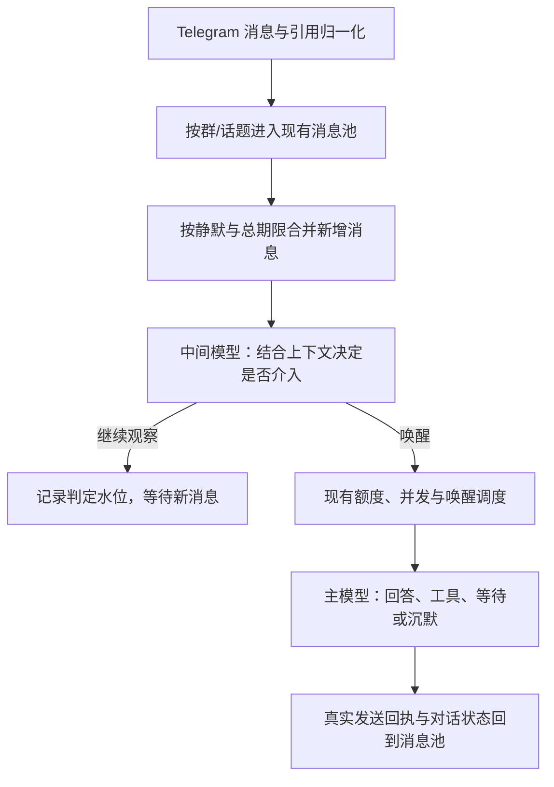

# Telegram 仿真群友改进计划 v3.0：消息池由中间模型判断

> 2026-10-30，状态：**V3-A/B/C 已实现、验收并发布；下一批 V2-C，再按 V3 适配 V2-D。**
> 用户决定：真正替换现有代码中的语义唤醒规则，由中间模型根据消息池上下文决定是否让主模型介入。
> **V3-C 已完成，V2-C/D 剩余范围已核对；M5 继续暂缓。** 见 [V3-C 记录](V3C_IMPLEMENTATION.md)，不恢复已退役的语义触发设计。
> 当前实际镜像为去哈希版本 `6ae4ada0`、social schema 11、`social-judge-v4`；消息语义判断统一使用独立 OAuth / `gpt-6-luna`。
> [V3-A 记录](V3A_IMPLEMENTATION.md)保留组件基线；[V3-B 记录](V3B_IMPLEMENTATION.md)包含统一入口、旧规则退役、OAuth 刷新、真实模型样例与本机启用结果。
> **V3C-01 已修复**：普通参与偏好与显式等待分开；直接纠正/偏好要求及时交主模型，21 个合成语境及安装镜像 4 例通过，详见 [V3-C 记录](V3C_IMPLEMENTATION.md)。

> 后续已完成 [迁移自建哈希清理](NO_HASH_IMPLEMENTATION.md)，改用 ID/修订号和直接比较。

## 1. 问题与目标

当前语义判断分散在昵称匹配、提问正则、关键词/成员条件、答后关注、潜水中断和普通消息概率中。
这些规则只能近似表达“在找谁、是否承接前文、是否值得参与”，叠加后既容易漏接，也难解释。

本次实际反馈已经确认：

- “快出发咯”只进入普通消息抽样，没有结合此前的出行对话判断接话价值。
- “肥鱼呢”已经收到，但话题根引用被当作回复别人；即使移除引用，昵称后接“呢/在”也存在匹配缺口。
  提问判定失败又阻止昵称兜底，最终落入 5% 抽样，未产生主模型回合。
- “你猜猜我给你准备了什么”无法仅凭当前代码稳定识别为向 Bot 发起交流。

V3 的目标是将这些语义选择集中到一个中间模型入口：**获准的新消息按批进入判断，不先用旧规则决定哪些值得看。**
中间模型决定是否需要主模型介入；主模型保留回答、工具调用、等待和合法沉默的选择。
不承诺被唤醒就一定发言，也不以每条群消息都产生公开回复作为成功标准。

## 2. 目标流程与职责

| 部分 | 职责 |
| --- | --- |
| Telegram 适配层 | 身份、话题、真实回复对象、@实体、编辑、媒体等事实归一化 |
| 代码与现有存储/调度 | 授权、暂停、时效、去重、合并、预算、版本、并发、期限、恢复和发送回执 |
| 中间模型 | 是否在找 Bot、是否承接前文、是否值得参与、是否值得中断等待或潜水 |
| 主模型 | 角色表达、完整推理、记忆与工具使用、公开发送及后续等待意图 |

所有获准的新成员消息批次都经过同一个判断入口，包括明确 @、回复和称呼。
这些信息作为强事实提供给中间模型，不再另设一条成功路径绕过它；明确找 Bot 时应优先唤醒，由验收约束。
平台命令仍走原命令路由，暂停/撤权是代码边界，不交给模型决定。
自身/其他 Bot、重复更新、编辑及入站时已过期事件不触发新的中间调用，沿用明确的入站资格边界；
其中可用的历史与自身已确认发言仍可成为上下文。合法接收后因预算延期的批次按自身期限处理，不冒充过期重放。

中间模型是一次有界的结构化 provider 调用，不建设第二个 Agent、工具执行循环、人格库或长期记忆库。
它不产生公开回复。主模型与普通助手共用工具、技能、MCP、共享记忆、Dream 和后台能力的既有约定继续有效；
上述组件分工不能变成对 social 主模型新增工具白名单。

## 3. 真正替换的范围

| 现有机制 | V3 处理 |
| --- | --- |
| 昵称子串与提问/挑战正则决定唤醒 | 删除消息唤醒路径中的语义判定；昵称和 Bot 身份变为中间模型输入 |
| `wakeProbability=0.05` 普通消息抽样 | 退出消息语义入口；不再先丢弃 95% 消息，参与价值交给中间模型 |
| 答后按参与者名单和固定窗口决定相关性 | 改为提供最近已确认发言、交互对象和时间；成员名单/窗口不再是接话硬门槛 |
| 关键词、指定成员、提问、普通消息等临时条件 | 归一为有来源、TTL、一次性状态的等待意图，交中间模型结合上下文解释；保留显式等待约束的含义 |
| `sleep_interrupts` 多项语义布尔开关 | 迁移为明确的潜水/中断意图，进入统一判定；潜水不在代码层丢弃全部普通消息 |
| 未完成句、短句长度决定额外静默 | 收敛为少量固定的消息合并与总等待上限；是否仍在说、是否值得等由模型结合消息判断 |
| 消息去重、SQLite、水位、唤醒队列、会话锁、预算、发送动作 | 继续复用，不重新实现另一套基础设施 |

不在旧触发树旁边增加一个仅处理“模糊消息”的分类器；不保留昵称/问号/随机/关注名单偷偷生成主回合的并行路径。
旧辅助逻辑若仍用于主模型的等待或展示，可保留必要部分，但不再承担消息语义准入。

### 等待、潜水与定时行为

- 保留有限/无限等待、带时区绝对期限、`purpose=reply/messages`、一次性与 TTL 的用户可见能力。
  时间计算、消耗和持久化由代码执行，等待什么、是否被新消息打断由中间模型解释。
- 主模型明确要求等某成员/内容时，中间模型需看到该意图，不能把它降成“任意消息来了就唤醒”。
  新的明确呼叫、改变话题或取消等待也作为上下文判断，而不是继续扩展词表。
- 睡前观察保留后台期限与无新内容本地完成的行为。新消息到来进入统一判断，不能因处于 observing/waiting/sleeping
  而走三套不同的语言规则；中间模型看到消息不自动等于主模型已经观察或读过消息。
- 主模型已明确请求的到期续接属于执行既有意图，按原期限调度，不因“没有新消息”丢失，也不重复过一次语义审批。
  普通答后检查没有新内容时本地结束，不为确认沉默而调用任何模型。
- M4 主动机会继续保留来源有效性、去重、期限和 quietHours；候选交同一中间入口判断参与价值，不绕过它直接制造闲聊。
  没有新消息、有效主动候选或明确续接事件时，两级模型均不调用；一次 observe 结果本身不生成周期复查。

## 4. 中间模型的输入与输出

### 输入：一个有界、可追溯的对话快照

- 本次新增消息及 seq、发言者、时间、真实回复对象、@实体、媒体说明；区分新增内容和历史上下文。
- 当前话题内近期对话，包含 Bot 最近实际确认发送的内容；有截断/历史缺口时明确标注。
- Bot 身份、昵称与必要的角色/群背景摘要，不复制主模型全部历史、记忆或工具输出。
- 主模型的等待/潜水意图、相关成员和内容、期限，以及当前是否正在执行。
- 最近参与情况的少量事实，例如距上次发言时间；先从现有记录取得，不以 V2-C 的完整统计实现为前置。

Telegram 话题根归属与真实回复必须区分。“在话题里发送”不能标成“正在回答创建话题的人”。
群/话题继续隔离；allTopics 仅表示各话题启用，不合成跨话题消息池。媒体缺少正文或识别结果时明确表示未知。

### 输出：只做一次准入决定

首版采用两种结果：`wake` 或 `observe`，附带本批覆盖的消息水位、唤醒所依据的消息 seq 和一句有长度上限的理由。
输出结构在 [V3-A](V3A_IMPLEMENTATION.md) 建立，V3-B 的 `social-judge-v2` 增加 `fulfills_intent` 表示满足显式等待；它不是公开回复，也不要求输出详细推理过程。

- `wake`：需要主模型查看；代码验证消息来源、版本、期限、额度后合并到现有主回合调度。
- `observe`：这一批暂不需要主模型；等新增上下文再判断，不自行安排循环检查。
- 允许上一批 observe 的内容作为后续上下文。新消息补全了意思时，可以引用仍保留且有效的旧消息唤醒，不能只看最后一条。
- 只接受当前快照实际提供的 seq 和合法枚举。超时、坏 JSON、缺字段或越界引用属于判断失败，不能当作 observe。

不在代码里根据理由文本再跑关键词判定；判断理由不能用作改变权限、配置或发送内容的命令。

## 5. 调度、成本与故障

### 复用现有生命周期

- 一个 Telegram 接收者、一个 SocialStore 所有者、一个 SocialScheduler，业务留在 Telegram social 边缘。
  中间调用状态写入同一 SQLite；不增加外部队列、第二套 LocalTrigger 重试队列或常驻服务。
- 每个 scope 同时至多一个中间判断、一个主执行；中间判断不占主 Agent 会话锁，不阻塞 Telegram 接收循环。
- 判断期间新消息继续入池。结果只覆盖实际提交的快照，较新的消息形成下一批；两者进入同一主回合时合并去重。
- 主模型忙时，判断为 wake 的内容优先交现有新消息展示机制；实际已经展示的消息不再制造第二次相同回合。
  尚未展示的内容保留，不能仅凭“主模型正忙”就算处理完成。
- 中间判定水位与主模型 seen/read 水位分开。observe 只能推进前者；主模型已读仍只确认实际展示的连续消息。
- 决定与候选入库原子提交，绑定快照水位、配置/角色版本和主回合消费状态。重启不重放已完成决定，
  未完成调用按期限恢复；暂停、撤权、换角色后旧结果失效。
- 现有主动候选不得把已 observe 的旧未读直接升级成主唤醒；若仍是有效来源，应经过中间入口且遵守来源去重。

### 成本与失败处理

- **旁观不再保证零模型成本。** 每个有效新消息批次通常调用一次中间模型；主模型仅在 wake 或已有明确续接时调用。
- 采用短静默窗口、固定总等待上限和有界上下文；连续消息合并，但持续刷屏不能无限延后明确交流。
  首版参数沿用现有配置边界落定，不在本大纲提前指定全部数值。
- 中间模型的 provider/model、超时、输出上限、批次速率和预算独立声明，复用现有 provider factory 与凭据解析。
  主模型配置与原有每小时唤醒/发送额度不被暗改；中间调用不冒充“零成本本地检查”。
- 中间调用失败采用有界重试，仍失败时该批可降级交主模型判断一次，受主额度、去重与期限约束。
  这条故障路径覆盖整个待判批次，不恢复旧昵称/问句/概率触发树；主模型仍可沉默。
- 中间或主预算不足时合并保留仍有效内容并记录延期；到期记录明确原因，不伪造已读或集中补发过期消息。
  同一批不得因 API 错误反复唤醒主模型。V3-A 已冻结最多两次尝试、全局 240 次/小时中间请求与 6 次/小时降级意图；
  实际主回合投递的原子接线与预算复验在 V3-B 完成。

## 6. 配置迁移与代码收敛

1. V3-A 已新增中间模型配置、输入/输出契约及版本化存储，实际 schema 8 已事务升级至 9；详见实现记录。
   保留群范围、角色、历史、水位、记忆、已确认发送与共享工具权限。
2. 梳理 V2-A/B 配置和 `social_wait` / `social_set_wake`：期限、作用域和一次性状态保留，语义条件归一为等待意图。
   中间模型看到的意图与主模型工具返回一致，旧调用不能成功返回却实际没有作用。
3. 明确废弃字段映射表：`wakeOnQuestion`、`wakeOnMessages`、`wakeProbability`、关键词/成员条件、
   `sleepInterrupts`、答后关注和未完成句相关参数逐项说明迁移后效果。
   昵称仍作为身份资料保留；概率字段退役不能悄悄继续抽样，也不能声称与新模型判断完全等价。
4. 保留基础消息合并、时间、预算和执行字段；配置校验、manifest、既有 JSON 编辑入口和文档同步更新。
   不建设 M5 专用面板，也不长期维护两套可切换的语义运行模式。
5. 主动调用链切换后，移除旧消息触发分支、死配置与只验证旧行为的测试，保留基础设施回归和已发现问题的行为用例。
   不为迁移建立通用分类框架或大范围改造 AgentLoop/Runner。

本机启用属于 V3 可运行批次的发布工作，使用原有备份与健康检查；失败回滚用旧代码配套原库和配置备份。
回滚不等于在 V3 进程里同时运行一套旧语义兜底。

## 7. 实施分批与优先级

| 批次 | 交付范围 | 完成要求 | 状态 |
| --- | --- | --- | --- |
| V3-A：契约与中间调用 | 冻结消息快照/决定、模型与预算配置、旧字段/工具映射、故障降级；provider 调用与最小持久状态 | 结构化调用、配置与事务测试通过；组件可独立验证，不宣称消息入口已替换 | 已发布 `c388ddb9`，schema 9；入口未切换 |
| V3-B：统一入口与删除旧规则 | 全部新消息批次接入；话题引用归一化；忙时投递、水位、等待/潜水/主动候选整合；删除并行语义触发 | 完成首个端到端替换，实际实例启用；昵称、问句、随机等旧分支不再生成主回合 | 已发布 `c9af722b`、schema 10；独立 OAuth/自动刷新及安装镜像真实调用通过 |
| V3-C：体验验收与收敛 | 真实反馈用例、判断记录、成本与延迟核对、死配置清理、发布记录 | 验收矩阵通过，记录实际模型/参数/调用量及剩余问题；确认下一批 V2-C/D 的剩余范围 | 已发布 `e9669e5d`；V3C-01、21 个真实模型样例、成本核对和展示清理完成 |

三个批次是 V3 内部交付顺序；**V3-B 的实际替换优先于任何 V2-C 功能开发**，不将旧机制扩展当作前置工作。
每个可运行行为批次按本机约定检查、提交、部署；组件批次若不改变实际入口，明确记录尚未启用。
仅本大纲和优先级更新不构建、不重启、不修改实际实例配置。

V3 完成后：V2-C 的参与统计可作为中间/主模型的事实输入，主动节奏只保留必要的机会调度；
不再加回消息概率门槛、成员关注硬筛选或新的语义规则树。V2-D 的收尾修复围绕判断/主回合状态调整，
不恢复“默认关键词触发”。V2-E/F 继续按原功能范围推进，M5 最后重新评估。

### 7.1 V3-C 优先问题：V3C-01 普通观察被误描述为选择性等待

**状态：2026-10-29 确认，2026-10-30 已在 `e9669e5d` 修复并部署。以下保留问题基线；验收与成本见 [V3-C 记录](V3C_IMPLEMENTATION.md)。**
观察版本 `c9af722b`，中间模型 `openai-codex/gpt-6-luna`，提示协议 `social-judge-v2`。

实际复现：Bot 回复夜市推荐后，用户说“你别用繁体字”。消息已入池且中间调用成功，
但结果为 `observe`，理由为“这是对繁体字的明确偏好要求，但并非提问；当前选择性等待问题，不必因此打断”。
直到下一条“最推荐哪个”触发 `wake`，主模型才看到前述要求、改用简体，并成功记录为 confirmed 偏好记忆。
这次延迟处理发生在语义判断环节；接收、OAuth、主回合调度和发送均无错误。

定位到 `JudgeCoordinator._intent`（`nanobot/channels/telegram/social/judge_runtime.py`）：
旧的常驻配置 `wakeOnQuestion=true` 在普通 `observing` 状态下也会生成 `JudgeIntent`，
带有 “An explicit wait is selective” 和 `waiting_for_questions=true`。
当时没有显式等待任务，输入的 `purpose`、`until` 均为 null；中间模型的理由却明确采用了“选择性等待问题”的前提。

修复方向与边界：

- 意图归一化必须区分普通参与偏好与真实、仍有效的显式等待/潜水意图。旧常驻开关不能凭空生成“正在等待问题”的状态。
- 根据上下文识别对 Bot 的直接纠正、表达偏好调整和行为要求，即使不是疑问句，也应及时交给主模型处理。
  主模型仍可选择简短确认、更新偏好或沉默，不要求一定公开发言。
- 继续由同一个中间模型判断，不新增“纠正词表”、问句正则或绕过中间模型的直接唤醒路径。
- 保留真实显式等待的选择性、TTL、一次性消耗及有限/无限等待语义，避免修复变成所有普通消息均唤醒。

验收要求：

1. 在 `observing`、无有效显式等待、旧 `wakeOnQuestion=true` 的情况下，快照不得声称 Bot 正在选择性等待问题。
2. “你别用繁体字”等指向 Bot 的直接调整要求，应在该批次交给主模型，不依赖下一条提问才处理。
3. 有效的明确等待某成员/内容仍能观察无关聊天；到期、一次性消耗、明确新呼叫的处理保持正确。
4. 真实模型语境样例验证判断效果；确定性测试验证意图输入、同批投递和状态边界，两者分开记录。

本次实际反馈基线：6 条成员消息对应 6 次中间调用，4 个主回合均完成、共 6 条 Bot 消息确认发送，
无重试、降级、重复发送或挂起。中间调用约 2.4–2.8 秒，从入池到首条回复约 7.2–11.5 秒；
6 次中间调用共 35,895 Token，每次约 6000 Token。延迟和上下文压缩列为 V3-C 后续体验核对项。

## 8. 验收与完成定义

| 场景 | 预期 |
| --- | --- |
| “肥鱼呢 / 肥鱼在吗 / 肥鱼呢？” | 中间模型识别明确找自己并 wake；话题根引用、无标点、语气词不再导致代码漏判 |
| “快出发咯” | 能看到此前出行上下文，由模型判断接话价值；不得用固定 5% 决定是否有机会被看见 |
| “你猜猜我给你准备了什么” | 最近正在与 Bot 交流时能识别承接；上下文不足时允许保守 observe，不宣称无条件必答 |
| Bot 问完，用户回复“下午三点 / 好呀 / 你猜” | 结合上轮问题判断；不因未点名、短句或固定关注窗口结束而在代码层丢弃 |
| 群友互聊、引用旧昵称、相似人名 | 交模型区分对象，不以昵称子串或问号直接产生主回合 |
| @、直接回复与潜水中的明确呼叫 | 经同一中间入口可靠 wake；没有第二套正常语义路径，主模型仍可合法沉默 |
| 明确等待某人/某内容 | 意图、TTL 与一次性状态有效；无关消息可以观察，新的明确呼叫与取消意图可正确处理 |
| 普通观察时直接纠正或调整偏好（V3C-01） | 旧常驻配置不伪造显式等待；“你别用繁体字”等要求及时交给主模型处理，不等下一条提问 |
| 拆句、持续消息、相册与媒体 | 有界合并；主模型看到完整已选批次；媒体未知不伪造成理解，不按每条制造重复回合 |
| 中间判断中又来消息、主模型忙 | 旧结果不吞新消息；已实际展示的消息不再次唤醒；pending 有来源、期限和最终状态 |
| observe 与后续语境改变 | 只推进判断水位；后续新消息可让仍有效的旧内容变得值得接，不污染主模型 read/seen |
| 超时、限流、坏输出与预算耗尽 | 错误不算沉默；有界重试/一次降级可查，不跑旧规则兜底，不产生重试调用链 |
| 无新消息、无有效主动/续接来源 | 两级模型均零调用；observe 不产生空轮询或固定答后复查 |
| 明确请求的到期续接 | 按原等待意图恢复，不因未读为空丢失；不重复请求中间审批 |
| 重启、暂停、换角色、跨话题 | 决定可恢复、候选不重复、旧版本失效，历史/记忆/路由与水位保持正确 |
| 真正删除旧入口 | 代码检查与集成测试证明旧 question/nickname/probability/attention 条件不再独立生成主回合 |

确定性测试使用模型/Telegram 替身、可控时钟和临时 SQLite，验证流程、输入事实、事务与故障行为。
另保留一组不含私有聊天的语境样例，用实际配置的中间模型离线评估正确唤醒/正确观察、漏判/误判、延迟与 Token；
模型质量评估与替身测试分开记录，不把固定替身输出当作已证明语义准确。评估不向真实群发送测试消息。

运行记录至少包括：批次/判断 ID、输入水位、配置/提示版本、模型、决定、短理由、延迟/Token、失败/降级、
最终主回合及发送结果。不重复落一份完整聊天，不记录凭据或详细思维链。

V3 完成必须同时具备：统一中间入口、旧语义分支退役、配置/工具迁移说明、受影响回归、模型样例评估、
实际本机发布与启用记录。当前 V3-A/B/C 与实际入口替换、语境评估、配置展示清理和本机发布均已完成；后续实际体验反馈持续记录，不将有限样例通过等同于零漏判。

## 9. 关联与后续

- [原迁移计划](../MIGRATION_PLAN.md)：M0–M4 历史范围与发布记录。
- [迁移计划 V2](MIGRATION_V2_PLAN.md)：A/B 已完成；C–F 在 V3 后按新入口重新核对。
- [V2-A 实现](V2A_IMPLEMENTATION.md)、[V2-B 实现](V2B_IMPLEMENTATION.md)：现有等待、存储、触发配置与兼容基线。
- [共用工具权限](SHARED_TOOL_PERMISSIONS.md)、[本机管线](LOCAL_PIPELINE.md)：继续适用。
- [V3-C 实现与发布](V3C_IMPLEMENTATION.md)：等待意图纠正、合成语境、成本核对和后续范围。
