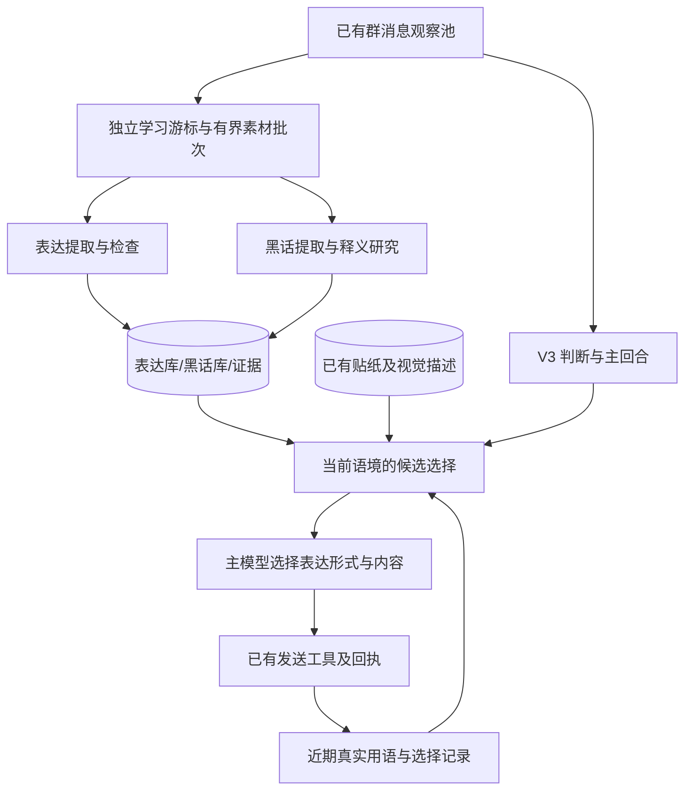

# Telegram 仿真群友迁移计划 V5：表达与黑话学习、自然接梗

> 2026-10-31，状态：**规划完成，V5-A/B/C/D/E 均未实施、未验收、未发布。**
> 本轮用户授权是编写 V5 文档；本文不修改实例人设、参数、数据库或运行行为。
> 最终目标：**模型理解梗的语境，会自然接梗、吐槽和选表情包，同时不把口头禅塞进每句话。**
> V5 优先补表达与黑话学习；接管 V2-E 的 G15，不另开一套重复学习工程。
> V3 广泛放行、V4 自主交流和共享工具权限保持现有契约；M5 专用管理界面继续暂缓。

## 1. 成功意味着什么

用户需要的是和当前群聊贴合的表达习惯：知道别人是在反讽、逗自己、认真求助还是单纯分享；
该接一句时接一句，该用表情时用表情，表达完能停。肥鱼人格保留，但不再依靠反复提及
「本大爷、白饭、Token、算力」证明自己在扮演肥鱼。

V5 必须同时达到以下结果，不能以“多了工具/记录/调用”代替：

1. 从真实群聊持续学习“什么情境下，群友怎样表达”，而非只积累词语释义。
2. 对陌生黑话积累语境、查证公开用法、保留不确定性，能随着解释和纠错更新。
3. 回复前能获得少量相关表达与贴纸候选，主模型可以选用、改写，也可以全部不用。
4. 普通闲聊不必每轮开玩笑，不必每句加口头禅、颜文字或一段人设表演。
5. 用没有“请玩梗/发表情”提示的自然对话回放，证明语境贴合、表达简短、重复减少。

这些学习主要改变外部知识与生成上下文，不训练模型权重，不承诺懂全部中文互联网梗。

## 2. 已核对的基线与真实缺口

| 项目 | 制定本文时的状态 |
| --- | --- |
| nanobot 源码 | `bea5a466`，本机 `main`；包含更优先用贴纸的角色偏好 |
| 实际运行镜像 | `41a25e72cbb9e1637034109218409574a618d017`；schema 13，social-judge-v8，主协议 5 |
| 已有贴纸能力 | 整包导入、分批看图标注、备注搜索和真实回执；LLM_Moe 的 120 张已学习，核对时收藏总数 121 |
| 已有群记忆 | `topic/pending/preference/experience/slang`，证据、修订、确认、删除、过期和一般召回 |
| 实际黑话积累 | 核对时 `memories.kind='slang'` 共 0 条；没有独立表达库或后台表达学习器 |
| 生成参数 | 实际解析为 `deepseek-flash`、temperature=0.1；V5 不先以改温度代替补机制 |
| qq-bridge 参考 | 本机 `/home/ubuntu/qq-bridge`，`a49877f`，主要参考二代仿真及黑话学习 |
| MaiBot 参考 | 2026-10-31 读取的源码 `c6429547af711555e3d4d1b8d04b413572cb616c` |

基线数目是一次快照，不作为未来必须恒定的配置或条数。实施前重新核对实际源码、实例和数据。

### 2.1 参考对象各自能提供什么

| 对象 | 借鉴的机制 | 不直接照搬的部分 |
| --- | --- | --- |
| MaiBot | 真实文字来源、排除 SELF 学习；情境/表达分开保存；候选审核、来源与出现记录；表达与黑话两条学习链；生成前选择表达 | 不承诺默认就有语义精准召回；其默认是加权候选注入，精细选择才使用向量/模型；不以复杂组件数量作为迁移目标 |
| qq-bridge | 滚动消息窗口、独立学习任务、候选提取、联网研究、含义/用法/例句/证据、人工纠正和确认、确认内容进入生成上下文 | 当前没有同等完整的情境—表达学习器；全局高频前若干项注入容易偏离眼前语境；不复制旧权限限制和强制逐词审批流程 |
| 当前 nanobot | 原生观察池、作用域、水位、SocialStore/Scheduler、主模型/工具、真实发送回执、已有记忆和表情库 | 不把 `slang` 类型、Dream 总结或一次表情图标注等同于持续表达学习 |

### 2.2 “像人但仍然怪”的机制假设

- 人设既要求“经常”使用固定口头禅，又要求自然和不重复；前者给了容易执行的具体模板。
- 一般记忆主要保存事实与待办，没有把群友的反讽、省略、收尾方式变成可复用表达。
- 待追问的召回加分与表达参考混在一个上下文里，可能让新闲聊被旧行程、未完成问题带偏。
- 贴纸备注需要主模型主动查询，目前是字面搜索，没有随当前语境提供候选。
- 自己生成的套话不断进入历史，容易延续原风格；目前没有专门的人工来源学习链纠偏。

这些是有代码与消息依据的假设，不是已经完成的因果实验。V5 用同一批自然语境回放检验，
不能把增加学习器后任意一句好回复当作全部问题已解决。

## 3. 范围与保留契约

### 本轮包含

- 表达与黑话素材收集、证据、独立后台学习和持久化。
- 情境—表达抽取、候选检查、修改/停用、按语境调用。
- 黑话候选、释义研究、用法与例句、确认/纠错/重新推断。
- 表达与贴纸候选进入主回合；近期口头禅使用事实与软性去重复提示。
- 区分当前话题、未完成事项和表达参考，减少“记事”抢占“接话”。
- 可检查的后台状态、成本记录、自然聊天回放与实际本机发布。

### 本轮不扩展

- 不做模型微调、全网自动爬梗、全量词典常驻注入或默认引入向量服务。
- 不移植 qq-bridge 的完整后台、权限白名单或全部 QQ 专属动作；不重写 V3/V4。
- 不把动态贴纸、语音、全量成员画像和 M5 管理面板列为 V5 前置条件。
- 不增加硬性的“每几轮必须发图”“每句话必须玩梗”或口头禅发送拦截规则。

### 必须保留

1. 新群聊继续由 V3 广泛放行给主模型；表达/黑话结果不作为唤醒门槛。
   其他 bot 继续作为群成员参与，不能因为其不作为默认学习范本就禁止接它的话。
2. 社交与普通助手共用现有工具权限、技能、后台任务和共享资料；V5 不收回这些能力。
3. 一个 Telegram 更新接收者、一个 SocialStore 所有者，复用现有调度和发布管线。
4. 发送仍区分 queued/sent/failed/unknown；普通 message 与 social 发送使用相同确认口径。
5. 主模型 seen/read 水位只由实际展示推进；学习器读取素材不等于主模型已经看过。
6. V4 的主动周期、停止主动联系、两次跟进上限、quiet 与发布额度不被暗改。
7. 不新增内容哈希、指纹或内容签名；用消息 ID/修订号、批次 ID、词条 ID、显式版本和原值比较。

## 4. 总体流程与落点

业务留在 `nanobot/channels/telegram/social/`，优先增加小型学习与表达选择模块，
复用 `store.py`、`scheduler.py`、`runtime.py` 和现有 hook。不在 AgentLoop/Runner 中塞入群聊专用流程。
工具入口仍放在 `nanobot/agent/tools/telegram_social.py`；配置在 Pydantic schema 中明确声明。

学习任务负责生成资料，不向群发送学习日志、研究过程或自动收录通知。
公开聊天仍由现有主回合与明确发布工具完成，不能因一次学习完成额外唤醒主模型刷一条确认。

## 5. 学习素材、持久化与生命周期

### 5.1 素材收集

- 从已授权 scope 的新消息观察事件收集，不依赖主模型决定是否发言；先持久化再后台处理。
- 原始事件携带 scope、message_id、seq、revision、sender_id、时间和真实来源类型。
- 默认学习真人本条消息的顶层文字。自身发言、其他 bot 发言可作为语境，默认不作为表达范本；
  用户明确要求学习某 bot 的说话方式时，可显式指定来源并保留标记。
- 引用、转发、工具输出、规划文本、系统/角色提示和模型图片描述不冒充真人本条文字。
  看图所学的贴纸含义留在贴纸库；以后如需学其用法，须关联真实聊天例子。
- 全部来源文本都是资料，不能将其中的命令提升为学习器或主模型的系统指令。

### 5.2 建议的数据契约

在现有 SQLite 中保存，最终表名在 V5-A 冻结；不预占未来 schema 版本号。

| 数据 | 最少需要的字段与含义 |
| --- | --- |
| 学习状态/批次 | scope、素材范围、源消息修订、批次 ID、类型、状态、尝试数、期限、配置修订、模型、用量/耗时/错误；表达与黑话各有处理游标 |
| 表达条目 | 稳定 ID、scope、适用情境、表达方式、语气/意图、适合与不适合的场合、来源、候选/可用/停用状态、出现记录、最近选用/确认使用记录、显式修订 |
| 黑话条目 | 稳定 ID、原词/别名、群内含义、公开含义、用法、例句、不适用情况、来源链接、证据、出现记录、上次推断依据、状态、显式修订 |
| 学习证据 | 条目 ID、来源 scope/message_id/revision/sender_id/时间、有界原文及必要的邻近上下文；能回查，不只留一个模型结论 |
| 本轮选择记录 | turn_id、当前目标消息、候选/选中条目 ID、版本、贴纸 ID、未选原因及失败状态；选中与实际发布分开 |
| 修改/停用记录 | 目标 ID、修订、操作来源、适用范围、停用/纠错理由；防止旧证据再次自动恢复已否定的含义或表达 |

出现次数不能简单当作喜爱度；选中过不等于说过，说过不等于群友觉得好笑。
精确字面复现和模型申报的表达使用分开记录，不用一个未经校准的“幽默分”自动强化表达。

### 5.3 故障和恢复

- 学习游标独立于 V3 判断、主模型 seen/read、记忆清理水位；没有候选也应记录成功处理的批次。
- 待处理批次保留有界原文与必要邻近语境，或明确保证对应来源在处理前可读取；不能依赖会滚动裁剪的
  观察池永久保留素材。积压超限或证据已缺失时记录跳过范围和原因，不能伪造已完成学习。
- 同一源消息修订只处理一次；编辑、删除、撤权、停用、配置变更使相关旧结果过期或需要复核。
- 任务使用来源 ID/修订和租约恢复；进程退出取消调用，重启有界恢复，不从全量历史盲目重跑。
- 原子提交条目、证据、批次结果及对应游标；失败不伪造“已学习”，也不丢掉失败范围的新素材。
- 清空/删除学习库有单独范围说明；沿用现有记忆删除口径，不声称已删原聊天、共享资料或 Dream 档案。
- 原来 `social_memory(kind='slang')` 保持可用。导入新库须保留原 ID/证据映射及不确定状态，
  不凭旧的自由文本猜出已确认含义，不在两处分别维护互相冲突的同一词条。

## 6. 表达学习

### 6.1 学习的单位

抽取的是“对话情境 → 可以怎样表达”，包括反讽、顺势夸张、自嘲、简短认输、省略、收口等。
每条都必须回到具体真人来源，说明当时谁接谁、在表达什么态度；不需要逐字照抄原句。

提取器不把“加油”“你真棒”等脱离场景的泛化口号当成优质学习成果，不把人名、私人近况、
固定任务答案和肥鱼自己的招牌台词学成全局说话习惯。一个片段可以没有值得学习的表达。

### 6.2 提取、检查与转为可用

1. 有界批量收集真人原文与必要上下文，要求结构化候选和准确的来源编号。
2. 验证来源存在、修订一致、来源类型可学，剔除自己发言、提示示例和工具内容污染。
3. 检查情境与语气是否匹配、表达是否过度特指、是否靠辱骂或机械口头禅凑效果。
4. 同一 scope 下对相关候选做直接值比较和必要的语义合并，给已有稳定 ID 增加证据，
   不通过反复改写同一个梗制造大量“新表达”。
5. 来源明确且通过检查的条目可以自动变为可用；存疑的保留候选，允许操作者修改、启用或停用。
   不要求每条都手工确认，也不把模型的自评当成群友的认可。

默认不学习自己的发言尤其重要：旧套话可以进入近期使用统计，但不能反过来作为优质范本再学一遍。

## 7. 黑话学习与释义迭代

### 7.1 两条发现路径

- 后台从真实语料发现不确定、依赖群内语境的短词或表达；不为普通词制造新梗。
- 主模型遇到陌生表达可查询已有条目、提交候选和来源；查询/提交不能被当成必须公开追问的动作。

### 7.2 查明含义

- 先结合本群原始语境推断，再区分公开网络用法与仅在本群成立的含义。
- 公开用法需要研究时，沿用普通搜索/网页工具及现有权限，记录实际读过的正文来源，
  不把搜索标题、摘要或模型已有印象直接当作查证完成。
- 对比脱离语境与结合语境的解释可帮助识别群内特殊义，但这仍是模型推断，不是外部事实验证。
- 群友明确解释可成为直接证据；多段一致语境可以支持更新推断。搜不到或解释冲突时保留不确定，
  不向群友装作已经懂了，也不把本群昵称和玩笑误当作公开流行语。
- 保存含义、语气、用法、例句和不适用场合；仅知道释义的条目可以帮助理解，但不自动鼓励主模型使用。

### 7.3 状态与修改

区分“候选”“可帮助理解”“可自然使用”“有争议/停用”，不要只有一个模糊的 confirmed 布尔值。
来源可靠、语境一致并通过检查的条目可以自动转为可用；不确定项提供可选人工确认/纠正入口，
不将 qq-bridge 的逐条人工确认移植成所有学习的强制前置条件。

仅在新证据、明确纠错、配置的复核期限或手动要求下重新研究；任务状态记录上次使用的源消息版本。
不照搬 MaiBot 的固定出现次数，也不因主模型刚用了一次就增加“人类反复使用”的证据。
被否定的旧含义不能因为旧消息重新入窗而恢复，纠错版本要随召回一起生效。

## 8. 生成前选择：让学习成果真正影响回复

### 8.1 为本轮建立语境

输入以当前实际对话为主：最新消息与引用关系、说话对象、最近交互、话题变化和是否明确求助。
识别反讽、调侃、分享或严肃求助是语义任务，不增加关键词命中即“必须吐槽”的本地规则。
不让长久未完成事项自动充当这轮回复意图，也不把选择器理由当成主模型必须执行的命令。

### 8.2 选择并注入少量候选

- 从表达库和黑话库中召回当前 scope 的可用内容，连同当前意图交给有界语义选择。
  V5 首版可用数据库检索加模型筛选；不以安装 embedding 服务作为必要条件。
- 学习库小时可以直接给选择器有界候选；大于预算时必须明确截断和过滤依据，
  不能固定拿全局最热条目冒充当前语境相关。
- 选择器可以返回空；选中内容以可选表达参考的形式进入主模型临近生成的位置，
  而非把别人的原话提升为系统规则。主模型仍可不用或自然改写。
- 同一回合相同输入不反复调用选择模型；新消息或相关条目版本变化时才重新选择。
  对缓存依据直接比较消息 ID/修订和相关值，不创建输入哈希。

### 8.3 把贴纸纳入同一次表达选择

- 复用已有视觉备注、情绪和用法，为当前语境提供少量贴纸候选；可以先做字面召回再语义排序。
- 主模型在纯文字、纯贴纸、贴纸配一句话和沉默之间选择。接梗/吐槽时保留用户优先用贴纸的偏好，
  不要求先写完整文字才能选图，不把贴纸意思再解释一遍。
- 对实际候选不确定时再看图；不每轮重读整包，不承诺关键词搜索一定有语义相关结果。
- 发送继续走现有工具、节奏和回执；候选推荐本身不自动发图、不额外消耗发送额度。

## 9. 口头禅、人格与记忆的协调

### 9.1 人设不再要求反复自证

在实现批次中审阅绑定角色及实际加载的共享资料：保留肥鱼身份、嘴硬、摸鱼和兴趣，
将“动不动”“经常挂着”等鼓励机械重复的表述改成依语境偶尔出现。
不把“每句话都说本大爷/白饭”作为人格一致性的验收标准，也不抹去用户明确指定的人设。

目前 Dream 可能把群内人格摘要写进 SOUL。后续修改须遵守现有 Dream 文件写入归属，
明确角色正文与派生摘要的来源、修订和更正路径；不能只改一处，让另一处旧摘要继续反向强化。
对话范例来自可追溯的实际语料/人工认可，不把模型临时编的“好接梗”例子当成群友认可。

### 9.2 近期使用事实是软参考

- 从真实确认发送中整理最近已经出现的表达、口头禅和贴纸，适度提醒本轮可以换一种说法。
- 同时覆盖 social_send、social_sticker 和普通 message 的确认发送；多个气泡按一轮表达看待。
- 区分“在解释/引用这个词”和“无关话题又拿它作结尾”；前者不能因重复统计被误伤。
- 不建立口头禅硬黑名单，不强制把生成文本删词或替换成新口头禅；表情、无语符号也不能成为新固定尾缀。

### 9.3 事实、未完成事项、表达参考分开使用

沿用同一存储所有者和共享资料能力，但分清生成上下文中的用途：
当前问题所需事实、仍有意义的未完成事项、当前可选表达分别有独立预算与说明。
待追问的“active”不能自动压过新话题；当前消息已拒绝、计划变更或接梗不涉及旧事项时，
应按既有语义完成/放下，不为取消跟进而偷偷改低 V4 主动概率或减少参与机会。

## 10. 成本、配置与检查入口

### 初始工程预算建议

以下为待 V5-A 验证并冻结的首版预算，不是当前已生效设置，也不是判定好笑的阈值：

| 项目 | 首版建议 |
| --- | --- |
| 素材窗口 | 每 scope 最多 80 条真人文字，初始积累 10 条后可触发；窗口溢出记录原因与范围 |
| 批次节奏 | 每 scope 学习调用间隔至少 5 分钟；后台队列初始全局并发 1，主聊天优先 |
| 每批候选 | 表达最多 10 条；黑话最多 20 条；可以零条 |
| 回复候选 | 注入最多 3 条表达、5 条黑话解释、5 张贴纸的简短索引；总字符预算明确受限 |
| 调用次数 | 同一自然回合最多新增一次表达选择调用；学习/研究分开记账，不对每条群消息调用 |
| 故障 | 每次模型请求有明确超时；同批最多两次尝试；研究还需限制搜索/抓取次数及总用量 |

provider/model、学习频率、候选上限、选择预算、超时与重试全部在 schema 明确声明，
进入既有 JSON 配置契约和状态接口；不把 key、令牌或运行中游标写进公开配置。
默认复用当前 provider/preset 解析，学习和选择可独立指定模型，不改已有主模型、V3 模型或凭据。
模型仍可能失败；选择失败时使用原有自然回复路径，不为等学习结果阻塞聊天，不用随机硬塞梗兜底。

最少提供：学习进度/积压/错误查询、条目搜索/来源/修订、纠正/停用/删除，以及本轮候选选择说明。
可复用普通工具或增加轻量 social 管理入口，不建设 M5 面板；权限沿用已有工具授权。
状态明确区分：开关启用、采集到素材、已完成批次、有可用条目、被选中、确认使用和效果获认可。

## 11. 分批实施顺序

| 批次 | 要完成的工作 | 不能缺少的验收 |
| --- | --- | --- |
| V5-A：基线与数据接线 | 冻结数据/配置/预算；独立素材游标、持久队列与状态；保留已有记忆/贴纸/消息；建立真实闲聊基线 | 能在主模型未发言时积累素材；学习不推进主已读；重启/编辑/删除不丢新消息或重跑已完成批次 |
| V5-B：表达学习 | 真人语料提取情境—表达、来源检查、候选审核/合并、自动可用与可选人工修订；排除自身模板 | 由真实语料学出可追溯表达；不照抄 SELF/提示范例；修正停用后旧证据不复活 |
| V5-C：黑话学习 | 接管 G15；候选查询/提交、语境积累、公开用法研究、用法/例句与不确定状态、纠错迭代 | 能识别群内特殊义，搜不到时不编；新解释覆盖旧版本；不要求每词手工审批或每轮联网 |
| V5-D：按语境表达 | 生成前表达/黑话/贴纸候选、语义选择、近期重复软提示、人设表述清理、事实/待办/表达用途分开 | 自然闲聊可主动选贴纸；不相关候选可以全不用；口头禅减少且明确求助仍切题；不收窄 V3、不破坏 V4 |
| V5-E：实际对话验收 | 同配置前后回放、自然场景与对照场景、成本与失败核验、原实例发布及实际反馈修正 | 不仅通过结构测试；有自然度/语境/重复/贴纸选择的实际模型证据与局限说明，实际实例启用并健康 |

每批实现后按必要检查、提交、本机发布和健康确认推进，不要求额外群、Bot、商业审批或长期观察期。
实现边界可小步提交，但 A 的数据结构或 B 的学习条数不代表整个 V5 已完成。
各批新增 `V5*_IMPLEMENTATION.md` 或等价实施记录，列明实际版本、启用配置、验证和未完成项。

## 12. 验收矩阵与评估方法

### 12.1 结构与运行回归

| 场景 | 必须成立 |
| --- | --- |
| 只旁观、没触发主模型 | 真人新消息仍可进入学习批次；不因此发言或确认主模型已读 |
| 本人、其他 bot、引用/工具/图片描述混在上下文 | 能区分来源；默认只从真实真人本条文字学习表达，其他内容不冒充范本 |
| 学习期间来了新消息/原消息被编辑 | 批次绑定准确范围和修订；新消息留给后批；旧版本结果不能覆盖新证据 |
| 进程重启、超时、暂停或关闭学习 | 任务有界恢复或明确取消；聊天继续；不无限重试/整库重学 |
| 同一个黑话有公开义与群内义 | 分开保存和按当前 scope 理解；不把群内玩笑变成普遍事实 |
| 纠正、停用、删除条目 | 查询和当前注入均反映新版本；旧快照/旧素材不自动恢复 |
| 非本群数据或任意虚构来源 ID | 不作为当前学习证据；默认召回遵守现有 scope，普通共享工具能力保持原值 |
| 已确认发送与 queued/unknown 并存 | 近期已说内容只按真实回执记录；未知发送不为凑表达重新投递 |
| 配置/模型故障或预算耗尽 | 状态可见，选择降级不硬塞梗；旧群聊入口、工具和等待照常工作 |

### 12.2 实际模型的行为验收

采用有来源、必要脱敏的真实群聊片段，固定上下文、模型和参数，对比当前版本与 V5；
按消息 ID 确定训练/提取素材与留出评估片段，避免把评估句原样学进库后宣称泛化。
同时保留一组只改人设、不接学习库的对照，区分效果来自提示变短还是学习内容实际被调用。

至少覆盖这些连续对话：

1. 普通分享、被逗、反讽夸奖、无语贴纸：没有要求玩梗或发图，也能按语境接话。
2. 连续多个不同话题：不会每次都绕回本大爷/白饭/算力，不把另一种新短语当固定尾缀。
3. 群友发来表情、接着斗图或停止：能自然选图，适时收尾，不逐张描述图面或重复解释图意。
4. 认真问事实、明确求助、表达难受：照常切题回应，不能为了“巨魔”扭曲问题或敷衍。
5. 陌生梗、群内特殊义、群友纠正：不装懂，能更新理解；仅在有依据和合适场景时再使用。
6. 当前话题与旧行程/待追问并存：回应眼前语境，不把每条闲聊变成提醒和任务检查。
7. 当前没有合适表达/贴纸：正常短话、严肃回答或沉默均可，不强制完成玩梗配额。
8. 明确在聊 token、白饭或身份梗：允许自然复用，不因减少口头禅误伤真实话题。

### 12.3 记录什么，怎样判断完成

- 分开记录来源学习成功率、来源准确性、候选是否贴合、最终表达是否自然、过度解释/建议、
  无关口头禅复现、贴纸是否主动选择且贴切，以及事实/对象是否误判。
- 口头禅统计按确认发送的自然回合计算，多气泡一轮计数；同时列出原句，排除引用/解释/明确相关话题。
  不能通过大量沉默或漏回明确问题人为降低口头禅比例。
- 固定规则回归检查数据与发送契约；实际模型回放才检查语义。模型自评分作为辅助，
  重点片段由操作者盲看前后版本，不能把“模型说自己很好笑”当作验收。
- 目标是相较基线，普通闲聊无关口头禅复现下降、语境贴合与自然表达改善、贴纸选择更主动，
  同时明确问题接续、事实准确性和发送可靠性不退步；逐项报告不通过的样例，不用一个总分掩盖。
- 记录新增请求数、输入/输出 Token、选择额外延迟、后台积压与失败原因；学习一次性成本与日常成本分开。
- 回放使用替身发送，不向真实群投探针。合成/回放验证与真实使用反馈分开记录，后者不虚构为已完成。

## 13. 迁移、发布与完成清单

从实施时实际 schema 逐版事务升级，不提前把本文的表名/版本视为已落库。
对现有 scope、消息/修订、V3 判断水位、主已读/已见、角色、记忆/证据、贴纸描述/用量和配置做原值核对，
不复制出另一套聊天历史或重置既有跟进计数。失败回滚沿用现有匹配镜像和数据备份。

V5 全部完成时必须能回答：

- [ ] 从哪些真实消息学到了哪些表达/黑话，来源是否有效，失败和未处理部分是什么？
- [ ] 哪些表达已经可用，哪些仅用于理解，哪些被纠正或停用？
- [ ] 当前回合为什么获得这些候选，选了什么，是否实际发出，没选是否也正常？
- [ ] 她在不被提示玩梗/发图时，是否比基线更自然；不相关口头禅是否减少？
- [ ] 有没有靠漏回问题、降低参与度、机械删词或强制发图伪造改善？
- [ ] 源端和安装版本的必要检查、实际模型验收、费用/延迟和本机健康是否有记录？
- [ ] 全部实际开关、版本、数据保留和剩余局限是否明确，是否已部署到用户实际实例？

当前以上各项均为实施与验收要求，不在本文提交时勾选。

## 14. 依据与关联文档

- [MaiBot 学习配置](https://docs.maibot.chat/manual/configuration/bot-config)：表达与黑话分别学习，快速候选注入与精细选择的区别。
- [MaiBot 表达学习提示](https://github.com/Mai-with-u/MaiBot/blob/c6429547af711555e3d4d1b8d04b413572cb616c/prompts/zh-CN/learn_style.prompt)：真人来源、情境与表达。
- [MaiBot 表达选择](https://github.com/Mai-with-u/MaiBot/blob/c6429547af711555e3d4d1b8d04b413572cb616c/src/chat/replyer/maisaka_expression_selector.py)：生成前的可选表达与选择路径。
- [MaiBot 黑话推断](https://github.com/Mai-with-u/MaiBot/blob/c6429547af711555e3d4d1b8d04b413572cb616c/src/learners/jargon_miner.py)：语境证据、释义对比与迭代；实现可参考，不作为准确性证明。
- qq-bridge 本机 `src/slang-learner.js`、`src/bridge.js`、`RULES.md`：候选—研究—确认—注入、证据与用法例句。
- 本仓库 `nanobot/channels/telegram/social/memory.py`、`stickers.py`、`runtime.py`：现有可复用能力和本文确认的缺口。
- [原迁移总纲](../MIGRATION_PLAN.md)、[V2](MIGRATION_V2_PLAN.md)、[V3](MIGRATION_V3_PLAN.md)、[V4](MIGRATION_V4_PLAN.md)。
- [已部署表情包学习](STICKER_PACK_LEARNING.md)、[共享工具权限](SHARED_TOOL_PERMISSIONS.md)、[本机发布约定](LOCAL_PIPELINE.md)。
